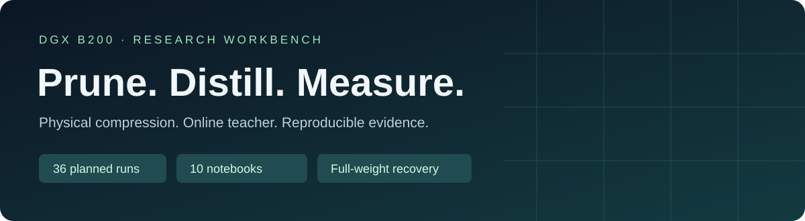
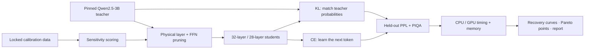

<p align="center">
  
</p>

<p align="center">
  <strong>Smaller architectures. A live teacher. Evidence before claims.</strong><br>
  A notebook-first, Minitron-inspired Qwen2.5-3B compression study for NVIDIA DGX B200.
</p>

<p align="center">
  <a href="DGX_B200_ONLINE/00_START_HERE.ipynb">Start here</a> ·
  <a href="downloads/DGX_B200_ONLINE.zip">Download notebook pack</a> ·
  <a href="docs/EXPERIMENT.md">Experiment design</a> ·
  <a href="docs/STATUS.md">Validation status</a>
</p>

> **Status: implementation packaged; local CPU checks passed.** The complete B200 training matrix and deployment benchmarks have **not yet been executed or validated**. This repository contains the runnable study, not finished DGX performance results.

## The question

**Does the cut that hurts least immediately also produce the best model after recovery?**

We physically remove transformer layers and coupled feed-forward channels, recover the resulting students with either teacher distillation or ordinary next-token training, and compare quality and execution cost under a fixed budget.

| Design choice | Default |
|:---|:---|
| Original model | Pinned **Qwen2.5-3B BASE**, 36 layers |
| Moderate student | **32 layers × 9,600 FFN channels** |
| Strong student | **28 layers × 8,192 FFN channels** |
| Pruning rules | Random · weight magnitude · single-layer calibration sensitivity |
| Recovery objectives | Text-only **CE** · full-vocabulary teacher **KL** |
| Repetition | **3 seeds**: 42, 123, 2026 |
| Main matrix | **2 sizes × 3 rules × 2 objectives × 3 seeds = 36 runs** |
| Trainable weights | **All student weights**, not just LoRA adapters |
| Teacher execution | Frozen BF16 teacher, GPU-resident alongside the student |
| Recovery budget | **1,966,080 processed input tokens per run** |

The token budget is **10 passes over 196,608 unique training input tokens**. It is not a claim of two million unique examples or NVIDIA-scale pretraining.

## From architecture to evidence



**Both models stay on the GPU during online distillation.** The teacher is frozen; only the student receives gradients. Student parameters and optimizer state use FP32, computation uses BF16 autocast, and gradient checkpointing reduces activation memory.

## Run it on JupyterHub

1. Clone this repository, or upload and extract the [notebook ZIP](downloads/DGX_B200_ONLINE.zip).
2. Open `DGX_B200_ONLINE/00_START_HERE.ipynb` using your working Blackwell-capable kernel.
3. Review `config.json`: teacher path, new run directory and assigned GPU UUID.
4. Run notebooks **00 → 08** in order. Notebook **09** covers conditional TensorRT-LLM support.

```bash
git clone https://github.com/DoC-Titan/minitron-dgx-b200.git
cd minitron-dgx-b200/DGX_B200_ONLINE
# Open 00_START_HERE.ipynb in JupyterLab.
```

The teacher must already exist locally with its verified `DOWNLOAD_RECORD.json`. Full model weights are not included in GitHub. The setup notebook records the actual hardware and software; notebook 03 proves a real full-weight update fits before the matrix starts.

### Notebook map

| # | Notebook | What it produces |
|:--:|:---|:---|
| 00 | [Start here](DGX_B200_ONLINE/00_START_HERE.ipynb) | Environment record, input verification, correctness checks |
| 01 | [Pruning](DGX_B200_ONLINE/01_PRUNING.ipynb) | Scores and exact original layer/channel recipes |
| 02 | [Teacher baseline](DGX_B200_ONLINE/02_TEACHER_BASELINE.ipynb) | Fresh common-data teacher evaluation |
| 03 | [Online KD smoke](DGX_B200_ONLINE/03_ONLINE_KD_SMOKE.ipynb) | Concurrent residency, gradients and real parameter update |
| 04 | [Train and evaluate](DGX_B200_ONLINE/04_TRAIN_AND_EVALUATE.ipynb) | 36 resumable runs, recovery curves, model exports |
| 05 | [CPU reference](DGX_B200_ONLINE/05_CPU_REFERENCE.ipynb) | Tiny CPU/CUDA train–prune–distil study |
| 06 | [Benchmarks](DGX_B200_ONLINE/06_BENCHMARKS.ipynb) | Paired quality, multi-size repeated CPU/GPU timings |
| 07 | [Report and export](DGX_B200_ONLINE/07_REPORT_AND_EXPORT.ipynb) | Tables, charts, completeness checks, compact results ZIP |
| 08 | [Live demo](DGX_B200_ONLINE/08_LIVE_DEMO.ipynb) | Teacher and distilled student on the same prompt |
| 09 | [TensorRT support](DGX_B200_ONLINE/09_TENSORRT_SUPPORT.ipynb) | Release-specific audit and optional engine workflow |

## What gets measured

| Question | Evidence |
|:---|:---|
| Is the model physically smaller? | Parameter counts, tensor shapes, exact recipes, checkpoint round trip |
| How much quality was lost? | Initial validation NLL, final held-out perplexity and custom PIQA200 |
| Did recovery help? | Validation quality against processed training tokens |
| Did the teacher help more than text alone? | Paired KL-minus-CE effects at the same size, seed and budget |
| Did the least-damaged cut stay best? | Immediate versus final ranking across pruning rules |
| Was execution actually faster? | Warmed, repeated 32/128/512-token prompt measurements |
| What did execution cost? | Load, preprocessing, transfer, model, decoding and end-to-end timing; allocator peaks |

The real-model comparison uses **CPU FP32 versus CUDA BF16**, so it combines hardware and precision effects. The tiny reference compares **identical weights at FP32** on both devices. Its byte-level perplexity is not comparable to Qwen's subword perplexity.

## Engineered for long runs

- One isolated subprocess per condition, with explicit GPU selection.
- Exclusive run lock; completed conditions are skipped on resume.
- Atomic hash-verified checkpoints with a previous generation.
- Pause at an optimizer boundary using a `STOP` marker.
- Fixed source/config/data/software record to keep experiments comparable.
- Export/reload verification before marking a model complete.
- A report completeness check that rejects missing measurements.

Plan for approximately **300 GB persistent disk** for all exports and active checkpoint generations. GPU fit is tested, not inferred from the B200 name. The old 20 GB allocator cap is not carried into this new study.

## How this relates to the 8 GiB study

The completed [RTX 4060 study](https://github.com/DoC-Titan/minitron-pruning-under-8gb) is the research starting point. This repository changes the recovery regime to full-weight online KD and adds a three-rule pruning comparison.

It bundles pinned inputs from that project with [source and file hashes](DGX_B200_ONLINE/UPSTREAM.json), then measures a **new baseline**. It does not import old results as DGX evidence or compare against the earlier notebook's differently scoped 13.53/34.357 perplexities.

## Read deeper

- [Experiment design and interpretation](docs/EXPERIMENT.md)
- [Run, pause, resume and recover](DGX_B200_ONLINE/README.md)
- [Validation status and remaining server checks](docs/STATUS.md)
- [Mandatory project requirement mapping](DGX_B200_ONLINE/REQUIREMENTS_MAP.md)
- [Local validation receipt](DGX_B200_ONLINE/LOCAL_VALIDATION.json)
- [Contributing evidence and code](CONTRIBUTING.md)
- [License and provenance boundaries](LICENSE.md)

**Minitron-inspired, built with Qwen.** Independent academic work; not an official NVIDIA reproduction. Qwen2.5-3B is governed by the Qwen Research License, including its noncommercial terms.
